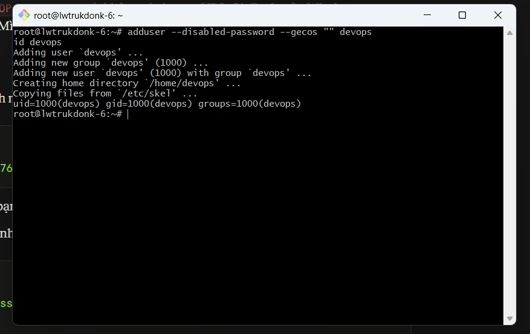
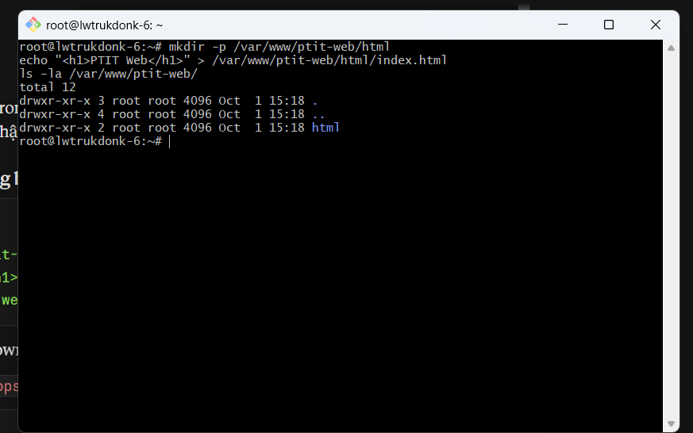
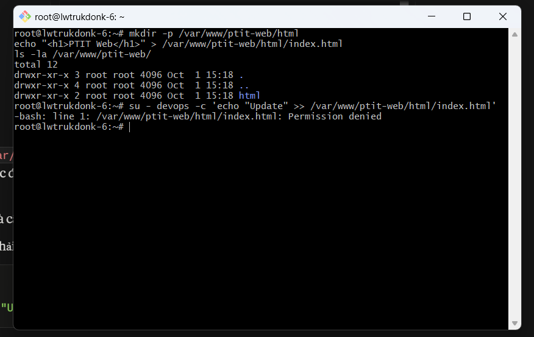
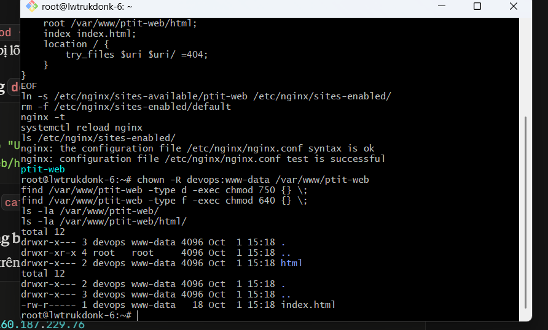
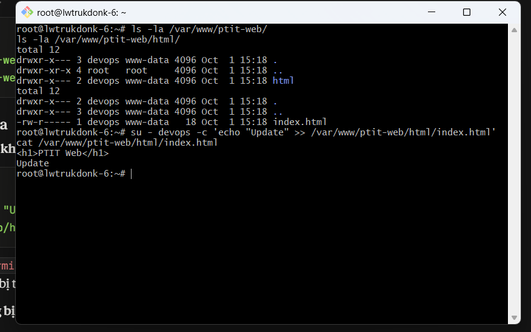
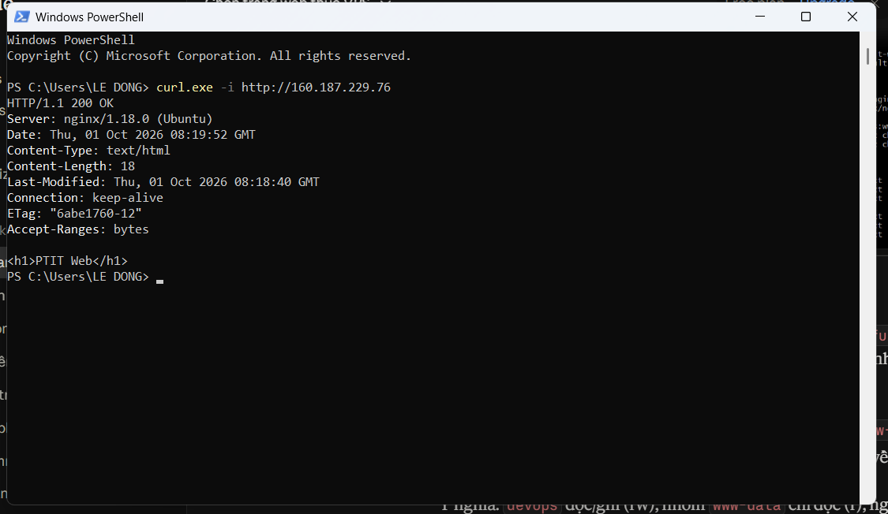
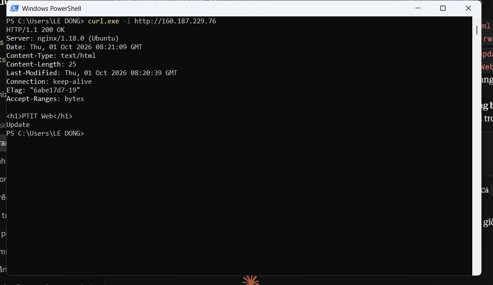

# Bài 5: Quản lý quyền sở hữu thư mục Web (Directory Permission Management)

- **Họ tên:** <điền họ tên>
- **VPS:** `lwtrukdonk-6` (AZVPS, gói Cheap 2) – IP: `160.187.229.76`
- **Hệ điều hành:** Ubuntu 22.04 LTS, web server Nginx 1.18.0

## 1. Mục tiêu
Phân quyền thư mục web tĩnh `/var/www/ptit-web/` để:
- User `devops` sửa được mã nguồn mà **không cần sudo/root**.
- Nginx (chạy dưới user `www-data`) vẫn **đọc** được và hiển thị website, không bị lỗi 403.

## 2. Chuẩn bị tình huống ban đầu

Tạo user `devops` (không đặt mật khẩu, dùng `su - devops` từ root):

```bash
adduser --disabled-password --gecos "" devops
id devops
```



Tạo thư mục web, thuộc sở hữu `root` (đúng bối cảnh đề bài):

```bash
mkdir -p /var/www/ptit-web/html
echo "<h1>PTIT Web</h1>" > /var/www/ptit-web/html/index.html
ls -la /var/www/ptit-web/
```

```text
total 12
drwxr-xr-x 3 root root 4096 Oct  1 15:18 .
drwxr-xr-x 4 root root 4096 Oct  1 15:18 ..
drwxr-xr-x 2 root root 4096 Oct  1 15:18 html
```



Thử ghi file bằng `devops` → **bị từ chối** (đây là vấn đề cần giải quyết):

```bash
su - devops -c 'echo "Update" >> /var/www/ptit-web/html/index.html'
# -bash: line 1: /var/www/ptit-web/html/index.html: Permission denied
```



Cấu hình Nginx trỏ `root` vào `/var/www/ptit-web/html` (file `/etc/nginx/sites-available/ptit-web`, bật bằng symlink trong `sites-enabled`, bỏ site `default`):

```nginx
server {
    listen 80;
    server_name _;
    root /var/www/ptit-web/html;
    index index.html;
    location / {
        try_files $uri $uri/ =404;
    }
}
```

`nginx -t` báo `syntax is ok` / `test is successful`, sau đó `systemctl reload nginx`.

## 3. Phân quyền

```bash
chown -R devops:www-data /var/www/ptit-web
find /var/www/ptit-web -type d -exec chmod 750 {} \;
find /var/www/ptit-web -type f -exec chmod 640 {} \;
```

(Các lệnh cũng có trong `setup_permissions.sh`.)

| Đối tượng | Thư mục | File | Ý nghĩa |
|-----------|---------|------|---------|
| Owner `devops` | `rwx` (7) | `rw-` (6) | Đọc, ghi, sửa mã nguồn |
| Group `www-data` | `r-x` (5) | `r--` (4) | Nginx đọc để phục vụ web |
| Others | `---` (0) | `---` (0) | Không có quyền truy cập |

**Vì sao dùng `find` thay vì `chmod -R 640` cho tất cả?** Thư mục cần quyền `x` (đi vào thư mục) thì Nginx mới truy cập được file bên trong. Nếu đặt 640 cho cả thư mục, Nginx sẽ bị lỗi 403 Forbidden. Vì vậy thư mục dùng 750, file dùng 640.

## 4. Kiểm tra

### 4.1. Đầu ra `ls -la /var/www/ptit-web/`

```text
total 12
drwxr-x--- 3 devops www-data 4096 Oct  1 15:18 .
drwxr-xr-x 4 root   root     4096 Oct  1 15:18 ..
drwxr-x--- 2 devops www-data 4096 Oct  1 15:18 html
```

```text
$ ls -la /var/www/ptit-web/html/
total 12
drwxr-x--- 2 devops www-data 4096 Oct  1 15:18 .
drwxr-x--- 3 devops www-data 4096 Oct  1 15:18 ..
-rw-r----- 1 devops www-data   18 Oct  1 15:18 index.html
```

Owner là `devops`, group là `www-data`, đúng yêu cầu. (Dòng `..` là thư mục cha `/var/www`, vẫn thuộc `root`, không nằm trong phạm vi bài.)



### 4.2. Ghi file bằng `devops`, không dùng sudo

```bash
su - devops -c 'echo "Update" >> /var/www/ptit-web/html/index.html'
cat /var/www/ptit-web/html/index.html
```

```text
<h1>PTIT Web</h1>
Update
```

Ghi thành công, không còn `Permission denied` như trước khi phân quyền.



### 4.3. Nginx không bị 403

Từ máy cá nhân (PowerShell):

```powershell
curl.exe -i http://160.187.229.76
```

Ngay sau khi phân quyền, trước khi sửa file: `HTTP/1.1 200 OK`, nội dung `<h1>PTIT Web</h1>`.



Sau khi `devops` ghi thêm dòng `Update`: `HTTP/1.1 200 OK`, nội dung hiển thị cả `PTIT Web` và `Update`.



## 5. Kết luận
- Thư mục `/var/www/ptit-web/` và toàn bộ nội dung có owner `devops`, group `www-data`.
- Quyền: owner đọc/ghi, group `www-data` chỉ đọc, others không có quyền (thư mục 750, file 640).
- User `devops` sửa file trực tiếp không cần `sudo`; Nginx vẫn đọc được qua quyền của group `www-data` và trả về `200 OK`, không bị lỗi 403.
- Nguyên tắc đặc quyền tối thiểu: không dùng `chmod 777`, không để others truy cập, không phải mở quyền thư mục `/root`.
